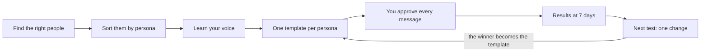

English | [Français](README.fr.md)

<p align="center">
  <a href="https://bereach.ai/claude-skills-for-linkedin?utm_source=github&utm_medium=readme&utm_campaign=linkedin-prospecting-skills">
    
  </a>
</p>

# LinkedIn Prospecting Skills for Claude

**Six Claude skills that find the right people, write to each one in your voice, and measure what works.**

BeReach users get **65% of their connection requests accepted, against a 21% industry average**, and a 22% reply rate across active campaigns ([source](https://bereach.ai/claude-skills-for-linkedin?utm_source=github&utm_medium=readme&utm_campaign=linkedin-prospecting-skills)). These six skills are the method we built on that work.

<p align="center">
  <a href="LICENSE"></a>
  
  
  
  <a href="https://github.com/bereach-ai/linkedin-prospecting-skills/stargazers"></a>
</p>

<p align="center"><a href="README.fr.md">Lire en français</a></p>

Most LinkedIn outreach fails the same way: the wrong people, a message that recites their job title, and no way
to tell what worked. These skills give Claude the method good sellers use instead. Claude sorts your leads into
2 to 4 personas, learns your voice from messages that already got a reply, writes one template per persona with
a real fact about each person, and reads the results after 7 days so the next test is better than the last.

**Nothing goes out without your yes.** You approve every invitation and every message.

## Install

Pick one. The first is the quickest.

**What runs without BeReach:** the persona cards and the voice card work on what you paste, and every framework
is in the skill files to read and reuse. Finding the people, the fact about each lead, sending and the results at
7 days need [BeReach](#works-best-with-bereach).

Use one install method, not two, or each skill shows up twice.

### 1. Paste this into Claude Code

```text
Install the LinkedIn prospecting skills from https://github.com/bereach-ai/linkedin-prospecting-skills: clone it into a temporary folder, copy every folder in its skills/ to ~/.claude/skills/ (replace any older copy of the same name), delete the temporary folder, then start the linkedin-outreach-method skill.
```

If Claude asks you to open a new session, do it once, then write: `Start the LinkedIn outreach method.`

### 2. Claude Code plugin

```text
/plugin marketplace add bereach-ai/linkedin-prospecting-skills
/plugin install linkedin-prospecting-skills@bereach-skills
```

### 3. Any agent that reads SKILL.md

```bash
npx skills add bereach-ai/linkedin-prospecting-skills
```

### 4. claude.ai and Claude Desktop

1. Turn on **Settings > Capabilities > "Code execution and file creation"** ("Create and edit files" in the newer layout).
   On Team or Enterprise, an admin first turns on Skills and code execution in **Organization settings > Plugins & skills**.
2. Download this repo and zip each folder in `skills/` on its own, with the folder at the top of the ZIP.
3. Go to **Customize > Skills > "+" > Create skill > Upload a skill**. Upload all six, one ZIP per skill, then
   turn each one on: the skills read each other's references.

By hand in Claude Code: copy each folder in `skills/` to `~/.claude/skills/<name>/` (all projects) or
`.claude/skills/<name>/` (one project).

## The six skills

| Skill | What it does |
|---|---|
| [**linkedin-outreach-method**](skills/linkedin-outreach-method/SKILL.md) | **Start here.** Runs the whole loop: find, sort by persona, your voice, one template per persona, send, measure acceptance and replies at 7 days. |
| [linkedin-personas](skills/linkedin-personas/SKILL.md) | Builds 2 to 4 persona cards with you and puts each lead in one. A persona is a role in a situation, never a job title. |
| [linkedin-voice](skills/linkedin-voice/SKILL.md) | Learns how you write from 3 to 5 messages you sent, upgrades the weak parts, and checks every draft against your voice card. |
| [linkedin-messages](skills/linkedin-messages/SKILL.md) | Writes the invitation note, the first message and two follow-ups: one framework per message type, one real fact per lead. |
| [cold-email](skills/cold-email/SKILL.md) | Finds work emails and writes a short sequence per persona, which you send from your own mailbox. |
| [bereach-setup](skills/bereach-setup/SKILL.md) | Checks the connector and the skills, and clears old memory and instructions that fight them. |

The skills call each other by name. You only need to start the first one.

## What to ask Claude

Copy any of these into Claude once the skills are installed.

```text
Start my LinkedIn prospecting. My website is [your site].
```

```text
Here are 4 LinkedIn messages that got a reply. Learn my voice from them.
```

```text
Build persona cards for the people I sell to, then sort this list into them.
```

```text
Write the invitation and the first message for each persona.
```

```text
Show me this week's drafts to approve.
```

```text
Review my results and suggest the next test.
```

```text
Write a cold email sequence for the people on my list.
```

Have three things ready and the first round goes faster: your website (or two sentences on what you sell), your
3 best customers and what happened just before they said yes, and 3 to 5 messages that got a reply.

## How it works

Every step ends on one page. Only the steps that send, spend or set the words sent in your name wait for your
yes.



1. **Find.** Who fits your ideal customer, starting with people already in your network, then new searches.
2. **Sort by persona.** 2 to 4 cards. The title finds the card; the card writes the message.
3. **Your voice.** Your greeting, sign-off and words are kept. The craft upgrades what is weak.
4. **One template per persona.** Each message type has one framework. Each lead gets one true fact about them.
5. **You approve.** Drafts come in batches. Nothing is sent until you say yes.
6. **Results at 7 days.** Acceptance and replies, compared at the same age, per persona.
7. **Next test.** One change at a time. The winner becomes the new template.

## Built on research, not opinions

Every rule in a skill traces to a source in [`research/`](research/README.md): who the experts are, what each
framework says, what is proven and what is folklore. Each claim carries its evidence level, from **Official**
and **Measured** down to **Practice** (a named expert's method nobody measured) and **Folklore** (repeated
everywhere, no source found).

| Expert or study | What the skills take from it | Evidence |
|---|---|---|
| Becc Holland | The premise: every message opens on something true about the person | Practice |
| Wind and Cardozo (1974) | The ICP picks the companies, the persona picks the people | Practice |
| Adele Revella | Why each persona would buy, written on its card | Practice |
| Bob Moesta | The forces that make someone ready to change | Practice |
| Eugene Schwartz | Write about their problem, not your product | Practice |
| Neil Rackham | Tie every benefit to what they said, in a reply | Measured (vendor: his own firm, 35,000 observed calls, never replicated) |
| Robert Cialdini | One real peer as proof in a follow-up, never a crowd | Measured, mixed replications |
| Josh Braun, Chris Voss | The last follow-up leaves a plain way out | Practice |
| Wang et al. (2025) | 3 to 5 real messages are enough to learn a voice | Measured (400+ authors, six models) |
| O'Keefe and Hoeken (2021) | Evidence persuades, gain or loss framing does not | Measured (1,149 studies) |
| Chapman (2008) | A persona with 9+ attributes matches almost nobody | Measured |
| Kohavi, Evan Miller | One change per test, sample size fixed before looking | Measured |

What every folder agrees on ([research/README.md](research/README.md)):

- **Relevance does the work, tricks adjust.** A real reason tied to the reader's role or recent activity is the
  strongest lever in every source.
- **Problem before product, interest before meeting, an easy no.**
- **Short, specific, plain.** 2 to 4 sentences for a first LinkedIn message, one checkable fact.
- **Measure your own.** Same persona, same week, random split, read at 7 days.

The research is honest about its gaps too: nobody has run a controlled test of one copy framework against
another, or of persona cards against no cards. The skills treat those as tests to run on your own numbers.

Start with [method](research/method/README.md), [personas](research/personas/README.md),
[voice](research/voice/README.md), [LinkedIn messages](research/linkedin-messages/README.md) and
[behavioural science](research/behavioural-science/README.md).

## Works best with BeReach

The skills are free to read, change and share. With [BeReach](https://bereach.ai/claude-skills-for-linkedin?utm_source=github&utm_medium=readme&utm_campaign=linkedin-prospecting-skills)
connected to Claude, they run the whole loop:

- **Find the people for each persona**, each with a reason to write to them now, dated when one exists,
  leaving out your customers and competitors.
- **Send what you approve** from your own LinkedIn account: invitations, first messages, follow-ups.
- **Read the replies** so every answer gets the right next message.
- **Measure acceptance and replies at 7 days**, per persona, and keep your persona cards and voice card
  across chats.

Set it up by giving Claude one line:

```text
set up bereach - https://bereach.ai/llms.txt
```

Claude connects BeReach, then offers to install the six skills. The first 14 days are free.
[See how it works](https://bereach.ai/claude-skills-for-linkedin?utm_source=github&utm_medium=readme&utm_campaign=linkedin-prospecting-skills).

## FAQ

<details>
<summary><b>Do I need BeReach?</b></summary>

To run the whole loop, yes. Without it, the persona cards and the voice card work on what you paste, and the
method and the message frameworks are in the skill files to read and reuse. Finding the people, the fact about
each lead, sending what you approve, reading replies and measuring at 7 days need BeReach.
</details>

<details>
<summary><b>Which Claude do I need?</b></summary>

For the skills: Claude Code, or claude.ai and Claude Desktop on any plan with code execution turned on (on
Team and Enterprise, an admin turns on Skills first). For BeReach: a Pro, Max, Team or Enterprise plan. Other
agents that read SKILL.md files can load them with `npx skills add`; they are written and
tested for Claude.
</details>

<details>
<summary><b>Does it send messages by itself?</b></summary>

No. Every invitation and every message is shown to you first and goes out only after your yes.
</details>

<details>
<summary><b>Which languages?</b></summary>

The pages Claude shows you are in your language, and the voice card is kept per language, so you can write
to leads in more than one. The skills know the formal forms (vous in French, Sie in German) and follow the
lead when they reply in a different one.
</details>

<details>
<summary><b>Is it free?</b></summary>

Yes. The skills and the research are MIT licensed: use them, change them, share them. BeReach is a paid
service with 14 days free.
</details>

<details>
<summary><b>How do I update?</b></summary>

Plugin: `/plugin marketplace update bereach-skills`, then `/plugin update linkedin-prospecting-skills@bereach-skills`
(or turn on auto-update for bereach-skills under Marketplaces in `/plugin`). Skills CLI: run `npx skills add bereach-ai/linkedin-prospecting-skills`
again. By hand: pull this repo and copy the folders in `skills/` again.
</details>

## Star history

If these skills help you book a call, a star helps the next person find them.

<a href="https://star-history.com/#bereach-ai/linkedin-prospecting-skills&Date">
  
</a>

## Built by BeReach

BeReach finds the right people for you to contact on LinkedIn, each with a real reason to write to them now,
and Claude writes the first message in your voice. More than 1,000 teams joined this year.

Offered by Benjamin Benoudis, co-founder of BeReach.
[Try it free for 14 days](https://bereach.ai/claude-skills-for-linkedin?utm_source=github&utm_medium=readme&utm_campaign=linkedin-prospecting-skills).

Contributions: see [CONTRIBUTING.md](CONTRIBUTING.md).

## License

[MIT](LICENSE)
